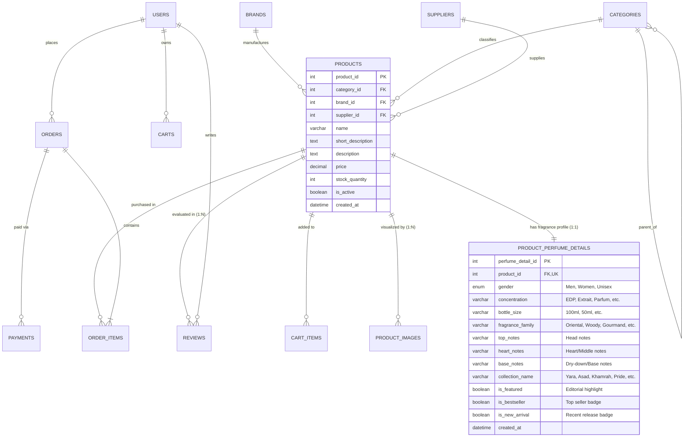

# PERFUME DATABASE DESIGN & SCHEMA ARCHITECTURE
**Online Shopping Database Management System — MUET DBMS CEP**  
*Department of Software Engineering, Mehran University of Engineering and Technology*  
*Target Isolated Databases: `online_shop_perfume_dev` & `online_shop_perfume_test`*

---

## 1. Architectural Strategy & Design Principles

The transformation from a generic catalog to an Arabian luxury perfume store requires capturing specialized fragrance attributes (olfactory pyramid, concentration, bottle volume, gender classification, and collection groupings) while maintaining 100% structural compatibility with the established MySQL 8 database schema.

### Core Principles
1. **Preservation of the Core Product Entity:** The existing `products` table remains the central entity for inventory, pricing, catalog status, and relationships to `cart_items`, `order_items`, `reviews`, and `product_images`.
2. **Normalized 1:1 Extension Table:** Perfume-specific attributes are encapsulated in a dedicated extension table: `product_perfume_details`. This adheres to Third Normal Form (3NF) without modifying legacy foreign key constraints or column widths.
3. **Preservation of Business Logic:**
   - Atomic checkout stored procedures (`sp_place_order`, `sp_place_guest_order`) execute against `orders` and `order_items`. Because `order_items` references `product_id`, all transaction and inventory deduction logic remains untouched.
   - Triggers (`trg_before_order_items_insert`, `trg_after_order_items_insert`, `trg_product_images_single_primary_bi`, etc.) operate without disruption.
   - Historical orders and snapshots remain structurally valid.
4. **Isolated Database Environments:**
   - Development: `online_shop_perfume_dev`
   - Testing: `online_shop_perfume_test`
   - Legacy baseline `online_shop` remains untouched.

---

## 2. Entity-Relationship (ER) Diagram



---

## 3. Data Definition Language (DDL) Specifications

### 3.1 Extension Table: `product_perfume_details`

```sql
CREATE TABLE IF NOT EXISTS product_perfume_details (
    perfume_detail_id INT AUTO_INCREMENT PRIMARY KEY,
    product_id INT NOT NULL UNIQUE,
    gender ENUM('Men', 'Women', 'Unisex') NOT NULL DEFAULT 'Unisex',
    concentration VARCHAR(60) NOT NULL DEFAULT 'Eau de Parfum (EDP)',
    bottle_size VARCHAR(30) NOT NULL DEFAULT '100ml',
    fragrance_family VARCHAR(80) NOT NULL,
    top_notes VARCHAR(255) NOT NULL,
    heart_notes VARCHAR(255) NOT NULL,
    base_notes VARCHAR(255) NOT NULL,
    collection_name VARCHAR(100) NOT NULL DEFAULT 'Mainline Classics',
    is_featured BOOLEAN NOT NULL DEFAULT 0,
    is_bestseller BOOLEAN NOT NULL DEFAULT 0,
    is_new_arrival BOOLEAN NOT NULL DEFAULT 0,
    created_at DATETIME NOT NULL DEFAULT CURRENT_TIMESTAMP,
    CONSTRAINT fk_perfume_product
        FOREIGN KEY (product_id) REFERENCES products(product_id)
        ON DELETE CASCADE
        ON UPDATE CASCADE,
    INDEX idx_perfume_gender (gender),
    INDEX idx_perfume_family (fragrance_family),
    INDEX idx_perfume_collection (collection_name),
    INDEX idx_perfume_featured (is_featured),
    INDEX idx_perfume_bestseller (is_bestseller),
    INDEX idx_perfume_new (is_new_arrival)
) ENGINE=InnoDB DEFAULT CHARSET=utf8mb4 COLLATE=utf8mb4_unicode_ci;
```

---

## 4. Category Taxonomy & Brand Architecture

### 4.1 Perfume Department Hierarchy
To support structured navigation (Men, Women, Unisex, Eau de Parfum, Extrait, Collections), categories are seeded with slug-based routing:

| category_id | Name | Slug | Parent Category | Description |
|---|---|---|---|---|
| 100 | Fragrances | `fragrances` | NULL (Root) | Master Fragrance Department |
| 101 | Men's Fragrances | `men` | 100 | Masculine Cologne & EDP |
| 102 | Women's Fragrances | `women` | 100 | Feminine Perfumes & Mists |
| 103 | Unisex Fragrances | `unisex` | 100 | Universal Arabian Blends |
| 104 | Eau de Parfum | `eau-de-parfum` | 100 | 15–20% Concentration Fragrances |
| 105 | Extrait de Parfum | `extrait-de-parfum` | 100 | 25–40% High Concentration Scents |
| 106 | Perfume Oils & Attars | `perfume-oils` | 100 | Concentrated Oriental Oils |
| 107 | Gift Sets & Collections | `gift-sets` | 100 | Luxury Presentation Sets |

### 4.2 Brand Hierarchy
1. **Lattafa Perfumes** (Parent brand, UAE)
2. **Lattafa Pride** (High-end prestige line, UAE)
3. **Maison Alhambra** (Luxury artisanal European-style line, UAE)

---

## 5. Catalog View Integration: `v_product_catalog` & `v_perfume_catalog`

The existing `v_product_catalog` view is expanded to include perfume attributes via `LEFT JOIN product_perfume_details`, while dedicated view `v_perfume_catalog` provides first-class filtering:

```sql
CREATE OR REPLACE VIEW v_perfume_catalog AS
SELECT 
    p.product_id,
    p.name AS product_name,
    COALESCE(p.short_description, SUBSTRING(p.description, 1, 140)) AS short_description,
    p.description,
    p.price,
    p.stock_quantity,
    p.is_active,
    p.source_store,
    p.source_url,
    p.created_at,
    b.brand_id,
    COALESCE(b.name, 'Lattafa Perfumes') AS brand_name,
    b.country AS brand_country,
    c.category_id,
    c.name AS category_name,
    c.slug AS category_slug,
    parent_c.category_id AS parent_category_id,
    parent_c.name AS parent_category_name,
    parent_c.slug AS parent_category_slug,
    pi.image_id AS primary_image_id,
    COALESCE(pi.image_path, 'static/images/placeholder.svg') AS primary_image,
    COALESCE(pi.alt_text, CONCAT(p.name, ' perfume bottle')) AS primary_image_alt,
    COALESCE(r.avg_rating, 0.0) AS avg_rating,
    COALESCE(r.review_count, 0) AS review_count,
    ppd.gender,
    ppd.concentration,
    ppd.bottle_size,
    ppd.fragrance_family,
    ppd.top_notes,
    ppd.heart_notes,
    ppd.base_notes,
    ppd.collection_name,
    COALESCE(ppd.is_featured, 0) AS is_featured,
    COALESCE(ppd.is_bestseller, 0) AS is_bestseller,
    COALESCE(ppd.is_new_arrival, 0) AS is_new_arrival
FROM products p
LEFT JOIN brands b ON p.brand_id = b.brand_id
JOIN categories c ON p.category_id = c.category_id
LEFT JOIN categories parent_c ON c.parent_category_id = parent_c.category_id
LEFT JOIN product_perfume_details ppd ON p.product_id = ppd.product_id
LEFT JOIN product_images pi ON p.product_id = pi.product_id AND pi.is_primary = 1
LEFT JOIN (
    SELECT product_id, ROUND(AVG(rating), 1) AS avg_rating, COUNT(*) AS review_count
    FROM reviews
    GROUP BY product_id
) r ON p.product_id = r.product_id;
```

---

## 6. Stored Procedures & Triggers Compatibility Audit

| Procedure / Trigger | Status | Compatibility Verification |
|---|---|---|
| `sp_place_order` | PRESERVED | Inserts to `orders` and `order_items`; checks inventory on `products.stock_quantity`. No dependency on `product_perfume_details`. |
| `sp_place_guest_order` | PRESERVED | Identical to member checkout with guest snapshot metadata. Compatible. |
| `sp_cart_summary` | PRESERVED | Sums `cart_items` * `products.price` + taxes. Compatible. |
| `sp_cancel_order` | PRESERVED | Restores inventory to `products.stock_quantity`. Compatible. |
| `sp_merge_carts` | PRESERVED | Merges session carts to user carts. Compatible. |
| `trg_before_order_items_insert` | PRESERVED | Validates stock and calculates price. Fully compatible. |
| `trg_after_order_items_insert` | PRESERVED | Deducts `products.stock_quantity`. Fully compatible. |
| `trg_product_images_single_primary_bi/bu`| PRESERVED | Maintains single primary thumbnail invariant in `product_images`. Fully compatible. |

---

## 7. Migration File Reference
All DDL and catalog adaptations are defined in:
`sql/12_perfume_transformation.sql`
