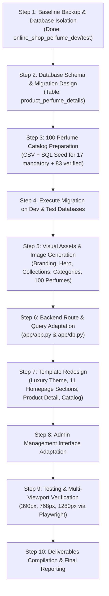

# PHASE 4: PERFUME E-COMMERCE DOMAIN TRANSFORMATION PLAN
**Online Shopping Database Management System — MUET DBMS CEP**  
*Department of Software Engineering, Mehran University of Engineering and Technology*  
*Semester 3 | Course: Database Management Systems (DBMS)*

---

## 1. Executive Summary & Objective

This transformation plan establishes the end-to-end multi-agent execution strategy to transition our generic e-commerce web platform into a dedicated, high-end Arabian perfume store demonstration inspired by the official **Lattafa** fragrance shopping experience.

The transformation strictly maintains the core technical foundation:
- **Language & Framework:** Python 3.11, Flask, Jinja2
- **Database Engine:** MySQL 8.0 (InnoDB) with PyMySQL
- **Frontend Architecture:** Semantic HTML5, CSS3 (Custom Luxury Design System with Bootstrap 5 utility foundation), Vanilla JavaScript
- **Security & Business Logic:** Session management, CSRF protection, RBAC (Customer, Staff, Admin), Atomic stored procedures (`sp_place_order`, `sp_place_guest_order`), triggers, audit logging, and payment recovery.

---

## 2. Strict Project Constraints & Guardrails

1. **Database Isolation:**
   - Primary legacy database `online_shop` remains strictly untouched.
   - Separate isolated development database: `online_shop_perfume_dev`.
   - Separate isolated test database: `online_shop_perfume_test`.
   - Full baseline backup created at `backups/pre_phase4_perfume_transformation_recovery.sql`.
   - Template & static assets backed up at `backups/pre_phase4_templates_backup/` and `backups/pre_phase4_static_backup/`.
2. **Architecture Integrity:**
   - No framework rewrites (no React, Next.js, Node.js, Express, TypeScript, ORM).
   - No external AI services, recommendations engines, or heavy JavaScript bundles.
   - Stored procedures, triggers, views, and order state machines remain 100% operational.
3. **Deployment Scope:**
   - Local demonstration only. No cloud deployment or GitHub pushing in this phase.

---

## 3. Visual Identity & Brand Direction

* **Reference Inspiration:** The official Lattafa fragrance storefront (curated for an academic university demonstration).
* **Atmosphere:** Arabian luxury, opulence, artisanal perfumery, elegance, and clarity.
* **Color Palette:**
  - **Deep Charcoal / Noir:** `#111215`, `#1a1b20` (Backgrounds, dark contrasts, luxury cards)
  - **Muted Antique Gold:** `#c5a059`, `#d4af37`, `#b89047` (Accents, badges, active tabs, buttons)
  - **Warm Ivory / Cream:** `#fcfbf7`, `#f7f4ee`, `#f0ede6` (Storefront background, typography on dark)
  - **Warm Amber:** `#c88a35`, `#b36b22` (Fragrance notes highlight, highlights)
  - **Champagne / Beige:** `#eadecc`, `#d6c8b2` (Subtle borders, dividers, card elevation)
* **Typography:**
  - **Headings & Titles:** Serif display font styling (`Cinzel`, `Playfair Display`, `Cormorant Garamond`, serif)
  - **Body & Navigation:** Clean, modern sans-serif (`Inter`, system-ui, sans-serif)

---

## 4. Multi-Agent Work Organization

* **Agent 1 (Project Lead & Architect):** Orchestration, safety guards, deliverables synchronization, overall quality control.
* **Agent 2 (Database Engineer):** Schema expansion (`product_perfume_details`), indexes, category/collection hierarchy, migration script `sql/12_perfume_transformation.sql`.
* **Agent 3 (Product Data Engineer):** Curating exactly 100 authentic perfumes (including the 17 mandatory fragrances), fragrance pyramid (top/heart/base notes), size, concentration, gender, PKR pricing, and generating `PERFUME_CATALOG_DATA.csv`.
* **Agent 4 (Image & Asset Engineer):** Generating branded SVGs and visuals for branding, hero banners, collections, categories, and all 100 individual perfume bottles.
* **Agent 5 (Backend Engineer):** Updating Flask routes (`app/app.py`), integrating perfume attributes, collection filtering, gender categorization, faceted search, and admin forms.
* **Agent 6 (Frontend Designer):** Redesigning homepage (11 sections), modern luxury navigation, perfume product cards, rich fragrance detail page, and admin dashboard.
* **Agent 7 (QA & Verification Engineer):** Automated testing via `test_app.py`, SQL regression suite, viewport responsiveness checks (390px, 768px, 1280px) using headless browser automation.

---

## 5. Execution Steps & Roadmap

---

## 6. Deliverables Matrix

| # | Deliverable | Status / Destination |
|---|---|---|
| 1 | `PERFUME_TRANSFORMATION_PLAN.md` | Root workspace (this file) |
| 2 | `PERFUME_DATABASE_DESIGN.md` | Root workspace |
| 3 | `PERFUME_CATALOG.md` | Root workspace |
| 4 | `PERFUME_CATALOG_DATA.csv` | Root workspace |
| 5 | `PERFUME_TRANSFORMATION_CHANGELOG.md` | Root workspace |
| 6 | `PERFUME_TRANSFORMATION_TEST_RESULTS.md` | Root workspace |
| 7 | `PERFUME_TRANSFORMATION_FINAL_REPORT.md` | Root workspace |
| 8 | `README.md` | Root workspace (updated) |
| 9 | `PROGRESS.md` | Root workspace (updated) |
| 10 | `FINAL_PROJECT_STRUCTURE.md` | Root workspace (updated) |
