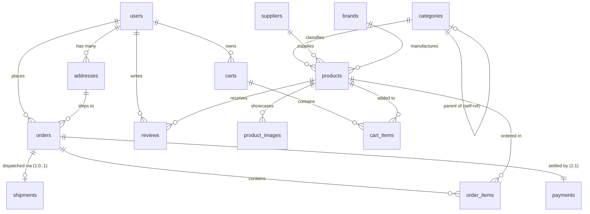

# COMPLEX ENGINEERING PROBLEM (CEP) PROJECT REPORT
## Online Shopping Database Management System

**Department of Software Engineering**  
**Mehran University of Engineering and Technology (MUET), Jamshoro**  

- **Course:** Database Management Systems (DBMS)  
- **Course Instructor:** Aisha Ashfaque  
- **Semester:** 3rd Semester, 2nd Year  
- **Assessment Score:** 10 Marks  
- **Team Ownership:**
  - **Member A:** Users & Access Module (`users`, `addresses`, `audit_log`, Roles, Security)
  - **Member B:** Catalog & Inventory Module (`categories`, `suppliers`, `products`, `reviews`, Inventory Triggers)
  - **Member C:** Orders & Payments Module (`carts`, `cart_items`, `orders`, `order_items`, `payments`, `shipments`, ACID Checkout Procedures)

---

## 1. Problem Identification

### 1.1 Problem Statement
Small-to-medium retail and wholesale enterprises in Pakistan routinely manage inventory, customer inquiries, order bookings, and shipping dispatches across fragmented spreadsheets (Microsoft Excel), messaging threads (WhatsApp), and manual paper ledgers. This non-relational, ad-hoc methodology leads to critical business and technical failures:

1. **Customer Record Duplication & Drift:** A single individual placing multiple orders under slightly varying names or telephone formats produces redundant, inconsistent records with no unified order history.
2. **Catalog Overselling & Phantom Inventory:** Multiple sales channels selling concurrently without concurrency control result in accepting payments for inventory that does not physically exist.
3. **Financial Inaccuracy & Price Mutation:** Calculating order totals manually frequently results in arithmetic discrepancy. Furthermore, updating a product's retail price in a naive table inadvertently retroactively alters past financial receipts and accounting balances.
4. **Absence of Tamper-Proof Audit Trails:** Changes to delivery milestones or order statuses cannot be attributed to specific users or timestamps, leading to customer disputes and lack of operational transparency.
5. **Operational Blindness:** Without structured relational aggregation, store managers cannot readily identify high-velocity stockouts, dormant carts, or regional market demand.

### 1.2 Intended Stakeholders

| Stakeholder | Key Responsibilities & Use Cases |
|---|---|
| **Customers** | Browse categorized catalog, execute keyword searches, inspect verified ratings, manage transient shopping carts, perform checkout, and track delivery progress. |
| **Warehouse & Support Staff** | Monitor real-time low-stock alerts, advance fulfillment stages (`pending` &rarr; `paid` &rarr; `shipped` &rarr; `delivered`), update courier tracking codes, and adjust inventory quantities. |
| **System Administrators** | Manage platform security, assign least-privilege database roles, perform catalog CRUD, execute cancellations with inventory restoration, and evaluate financial revenue reports. |

---

## 2. Requirements Specification

### 2.1 Functional Requirements (FR)
- **FR-1 [User Authentication & Security]:** Users can register with unique emails; passwords are encrypted with salted PBKDF2:SHA256 hashes prior to storage.
- **FR-2 [Role-Based Access Control]:** Every account belongs to exactly one role (`customer`, `staff`, `admin`), enforced at both MySQL database engine and web routing layers.
- **FR-3 [Multi-Destination Address Book]:** Customers can store multiple delivery addresses (1:N) with a single active default address flag.
- **FR-4 [Hierarchical Product Taxonomy]:** Products map to categories supporting self-referencing parent-child classification (e.g. *Electronics &rarr; Mobile Phones*).
- **FR-5 [Vendor Attribution]:** Each merchandise item is supplied by an audited vendor with merchant contact records.
- **FR-6 [Inventory Safeguards]:** Engine-level constraints reject negative prices or quantities (`price >= 0`, `stock_quantity >= 0`).
- **FR-7 [Shopping Cart Management]:** Customers maintain persistent session carts where line items can be added, updated, or removed.
- **FR-8 [Atomic Transaction Checkout]:** Converting a cart to an order occurs within an ACID transaction via stored procedure `sp_place_order`.
- **FR-9 [Concurrency Control & Oversell Prevention]:** A `BEFORE INSERT` trigger on order line items verifies stock in real-time, aborting transactions that exceed on-hand inventory.
- **FR-10 [Automatic Inventory Deduction]:** An `AFTER INSERT` trigger on line items decrements product stock synchronously with order creation.
- **FR-11 [Verified Purchase Reviews]:** Customers can only submit 1 to 5 star reviews on products they have actually purchased and had delivered.
- **FR-12 [Transactional Cancellation]:** Cancelling an order via `sp_cancel_order` automatically restores deducted inventory and records payment refunds.

### 2.2 Non-Functional Requirements (NFR)
- **NF-1 [Data Integrity & 3NF Normalization]:** Zero data redundancy, elimination of insertion/update/deletion anomalies, and mandatory foreign key integrity with explicit cascade/restrict rules.
- **NF-2 [ACID Transaction Consistency]:** Atomic commit/rollback behavior guaranteeing zero orphaned records or half-saved orders upon checkout failure.
- **NF-3 [Defensive Security & Injection Prevention]:** All application queries utilize parameterized prepared statements (`%s`); database accounts enforce the Principle of Least Privilege via MySQL 8 roles.
- **NF-4 [Performance & Indexing]:** Strategic B-Tree indexes on search attributes (`products.name`), foreign keys, and customer order history eliminating full-table scans.
- **NF-5 [Engine Auditability]:** Order lifecycle transitions automatically trigger immutable audit records in `audit_log` directly at the database layer.

---

## 3. Database Design & Normalization

### 3.1 Entity Rationale & Normal Form Justification
The database consists of **15 normalized relations** (enhanced in Phase 11 for real catalog depth, brands, and multi-image galleries), engineered in **Third Normal Form (3NF)**:
1. **1NF:** Every column contains atomic values; no repeating groups exist (e.g., secondary product images are stored as discrete rows in `product_images`, not comma-separated lists or JSON strings in `products`).
2. **2NF:** Every non-key column is fully functionally dependent on the entire primary key (vital for composite key junction tables `cart_items` and `order_items`).
3. **3NF:** No non-key column is transitively dependent on the primary key. For example, brand details are normalized into a dedicated `brands` table rather than repeating brand name/country inside `products`.

### 3.2 The `order_items.unit_price` Architectural Decision
A central design challenge in e-commerce database engineering is whether to store `unit_price` in `order_items` when `products.price` already exists. 
- *Pure normalization* might argue that storing price in both tables violates 3NF by introducing transitive redundancy.
- *Relational reality:* Catalog prices are mutable temporal attributes (e.g., a laptop priced at PKR 150,000 today may increase to PKR 165,000 next month).
- **Design Resolution:** Storing `unit_price` at the instant of order placement creates an immutable financial contract. If the merchant later adjusts product catalog prices, historic accounting ledgers, invoices, and tax receipts remain unaltered.

### 3.3 Entity Catalog

| Table Name | Primary Key | Foreign Keys | Key Constraints & Rules |
|---|---|---|---|
| `users` | `user_id` | None | `email` UNIQUE, `role` ENUM, salted hash storage |
| `addresses` | `address_id` | `user_id` &rarr; `users` | `ON DELETE CASCADE`, multi-address support |
| `audit_log` | `log_id` | None | Engine trigger population, immutable audit trail |
| `categories` | `category_id` | `parent_category_id` &rarr; `categories` | Self-referencing FK, `ON DELETE SET NULL`, `slug` UNIQUE, `image_path` |
| `brands` | `brand_id` | None | `name` UNIQUE, `slug` UNIQUE, 3NF brand normalization |
| `suppliers` | `supplier_id` | None | Vendor contact directory |
| `products` | `product_id` | `category_id`, `supplier_id`, `brand_id` | `CHECK (price >= 0)`, `CHECK (stock_quantity >= 0)`, `brand_id` FK &rarr; `brands`, `ON DELETE RESTRICT` |
| `product_images` | `image_id` | `product_id` &rarr; `products` | `ON DELETE CASCADE`, `is_primary` flag, single primary trigger validation |
| `reviews` | `review_id` | `user_id`, `product_id` | `CHECK (rating BETWEEN 1 AND 5)`, `UNIQUE(user_id, product_id)`, verified purchase trigger |
| `carts` | `cart_id` | `user_id` &rarr; `users` | `status` ENUM ('active', 'converted', 'abandoned') |
| `cart_items` | `(cart_id, product_id)` | `cart_id`, `product_id` | Composite PK, `CHECK (quantity > 0)`, `ON DELETE CASCADE` |
| `orders` | `order_id` | `user_id`, `address_id` | `status` ENUM, `total_amount >= 0`, `ON DELETE RESTRICT` on user |
| `order_items` | `(order_id, product_id)` | `order_id`, `product_id` | Composite PK, stored `unit_price`, inventory triggers |
| `payments` | `payment_id` | `order_id` &rarr; `orders` | `UNIQUE(order_id)` enforcing 1:1, payment rail tracking |
| `shipments` | `shipment_id` | `order_id` &rarr; `orders` | `UNIQUE(order_id)` enforcing 1:1, tracking number UNIQUE |

---

## 4. Entity-Relationship (ER) Diagram

### 4.1 ER Diagram Visualization
*(Exported PNG diagram located at `docs/er_diagram.png`)*



### 4.2 Major Relationship Narratives
1. **`users` to `addresses` (1:N):** One customer profile can store home, university, and corporate delivery destinations. Deleting a user cascades to remove their addresses.
2. **`categories` to `categories` (Self-Referencing 1:N):** Enables an arbitrary tree hierarchy without creating redundant tables. If a top-level category is deleted, child categories are preserved with `parent_category_id = NULL`.
3. **`orders` to `products` via `order_items` (M:N Junction):** Resolves the many-to-many relationship. Enforces composite primary key `(order_id, product_id)` to prevent duplicate product lines within an invoice.
4. **`orders` to `payments` (1:1):** Enforced by placing a `UNIQUE` constraint on `payments.order_id`. Every order is tied to exactly one transaction lifecycle.
5. **`orders` to `shipments` (1:0..1):** An order initially exists without a shipment record. A dispatch row is generated upon warehouse fulfillment.

---

## 5. Database Implementation

### 5.1 Technology Stack & Engine Configuration
- **DBMS:** MySQL Community Server 8.0.46 (x86_64)
- **Storage Engine:** InnoDB (Row-level locking, ACID transactions, foreign key enforcement)
- **Character Encoding:** `utf8mb4` with `utf8mb4_unicode_ci` collation
- **Driver / ORM Layer:** PyMySQL 1.1.1 executing pure, parameterized SQL queries
- **Application Web Framework:** Python 3.14 + Flask 3.0.3 + Jinja2 + Bootstrap 5.3

### 5.2 Summary of Database Scripts
- `sql/01_schema.sql`: Full baseline DDL defining 13 tables, keys, cascade rules, and check constraints.
- `sql/02_sample_data.sql`: Realistic Pakistani seed data (PKR currency, Pakistani names/cities, salted hashes).
- `sql/03_views_indexes.sql`: 4 performance B-Tree indexes and 5 business views.
- `sql/04_procedures_triggers.sql`: 4 business triggers and 3 stored procedures.
- `sql/05_roles.sql`: MySQL 8 RBAC security definitions and grant matrices.
- `sql/06_demo_queries.sql`: Advanced operational demonstration queries across 9 thematic sections.
- `sql/07_tests.sql`: Automated test harness asserting database integrity (15 tests, T1-T15).
- `sql/08_catalog_expansion.sql`: Phase 11 catalog migration adding `brands`, `product_images`, slug/image columns, trigger `trg_product_images_single_primary_bi`, procedure `sp_set_product_primary_image`, views `v_product_catalog` and `v_category_counts`, and performance indexes.

### 5.3 Baseline Dataset Overview
- **Categories:** 14 (5 top-level departments, 9 specialized subcategories with URL slugs)
- **Brands:** 14 leading Pakistani and international brands (Paklap, Samsung, Dell, Khaadi, Dawlance, etc.)
- **Suppliers:** 6 verified commercial vendors across Karachi, Lahore, and Islamabad
- **Products:** 81 active catalog items (expanded from 30 in Phase 11 via verified store manifest)
- **Product Images:** 81 multi-image assets cataloged with `is_primary` flags, display ordering, and local fallback paths
- **Users:** 15 accounts (2 Administrators, 2 Staff Members, 11 Active Customers)
- **Addresses:** 20 verified delivery locations across Karachi, Hyderabad, Jamshoro, Lahore, and Islamabad
- **Orders:** 25 historical orders spanning all stages (`delivered`, `shipped`, `paid`, `pending`, `cancelled`)
- **Order Items:** 39 order lines with zero mathematical discrepancies against order headers
- **Reviews:** 20 verified customer product reviews

---

## 6. Database Operations & Functionality

### 6.1 Data Modification (CRUD)
- **Parameterized Registration & Insertion:** Direct insertion of user accounts with salted password hashes.
- **Inventory & Price Adjustments:** Synchronized product price and stock updates respecting engine CHECK rules.
- **Cascading Deletion vs Deletion Restriction:** Safe removal of items from shopping carts while preventing deletion of products associated with historic orders (`ON DELETE RESTRICT`).

### 6.2 Advanced Joins & Reporting
- **5-Table Master Invoice Retrieval:**
  ```sql
  SELECT o.order_id, o.order_date, u.full_name, a.city, p.name, oi.quantity, oi.unit_price, pay.method, s.tracking_number
  FROM orders o
  JOIN users u ON o.user_id = u.user_id
  JOIN addresses a ON o.address_id = a.address_id
  JOIN order_items oi ON o.order_id = oi.order_id
  JOIN products p ON oi.product_id = p.product_id
  JOIN payments pay ON o.order_id = pay.order_id
  LEFT JOIN shipments s ON o.order_id = s.order_id
  WHERE o.order_id = 1;
  ```
- **Hierarchical Self-Join on Categories:**
  Reconstructs catalog hierarchy by joining `categories child` with `categories parent`.

### 6.3 Aggregations with `GROUP BY` and `HAVING`
- **VIP Customer Ranking:** Groups orders by `user_id` and filters via `HAVING total_spent_pkr > 30000.00`.
- **Geographic Order Concentration:** Aggregates delivery counts and sales volume by Pakistani destination cities.
- **Warehouse Inventory Capitalization:** Calculates tied-up inventory value grouped by supplier.

### 6.4 Correlated Subqueries & Analytical Views
- **Correlated Price Comparison:** Detects items priced above their category's real-time average.
- **Analytical & Catalog Views:**
  1. `v_order_summary`: Real-time order reconciliation across line items and payments.
  2. `v_low_stock`: Automatic replenishment warning for stock &le; 5 units with supplier telephone contacts.
  3. `v_sales_by_category`: Gross revenue and unit volume per department.
  4. `v_best_sellers`: Top products ranked by volume sold.
  5. `v_abandoned_carts`: Inactive shopping carts dormant for &ge; 7 days.
  6. `v_product_catalog` *(Phase 11)*: Denormalized catalog view joining `products`, `categories`, `brands`, `suppliers`, verified `reviews` aggregate rating/count, and the primary image path from `product_images` with COALESCE fallback. Eliminates N+1 query complexity on browsing and search pages.
  7. `v_category_counts` *(Phase 11)*: Hierarchical roll-up view calculating active product counts for both subcategories and top-level department heads via correlated child category aggregation.

---

## 7. Project Challenges & Engineering Solutions

Developing a high-concurrency relational system exposed several critical engineering challenges:

### Challenge 1: MySQL Error 1442 Trigger Re-Entrancy
- **Problem:** When inserting cart items into `order_items`, the `trg_after_order_items_insert` trigger attempted to execute `UPDATE products SET stock_quantity = ...`. Because the outer `INSERT INTO order_items SELECT ... FROM cart_items JOIN products` already had `products` open in its `FROM` clause, MySQL aborted the query with `ERROR 1442 (HY000): Can't update table 'products' in stored function/trigger because it is already used by statement which invoked this stored function/trigger.`
- **Solution:** In stored procedure `sp_place_order`, we decoupled the read and write locks by selecting cart items into a session `TEMPORARY TABLE _temp_checkout_items`. The subsequent `INSERT INTO order_items` read exclusively from the temporary table, allowing the trigger to safely acquire an exclusive lock on `products` without lock collision.

### Challenge 2: Preservation of Diagnostics Prior to Rollback
- **Problem:** In stored procedure error handlers, calling `ROLLBACK;` before `GET DIAGNOSTICS` reset the diagnostic area, wiping out the trigger's custom error message (`Oversell Error: Requested quantity exceeds...`) and returning an empty string to the user.
- **Solution:** We reordered the exception block to capture `GET DIAGNOSTICS CONDITION 1 v_err_msg = MESSAGE_TEXT;` *before* issuing `ROLLBACK;`, preserving the exact root-cause failure string for display on the web storefront.

### Challenge 3: Enforcing Verified Purchases at the Database Layer
- **Problem:** Web applications often enforce business logic like review eligibility in frontend code, which can be bypassed by direct API calls or SQL injection.
- **Solution:** We created `trg_before_reviews_insert` which directly queries the relational order history inside the database engine. If zero orders exist for that `(user_id, product_id)` with status `'delivered'`, the trigger executes `SIGNAL SQLSTATE '45000'`, making it physically impossible to store an unverified review.

### Challenge 4: MySQL 8 Role Privileges and Least Privilege Enforcement
- **Problem:** Web applications frequently connect as `root`, giving any compromised web shell total control over all tables.
- **Solution:** We established three database roles (`shop_admin`, `shop_staff`, `shop_customer`). The `shop_customer` role is explicitly denied `SELECT` on `users` and denied `DELETE` on catalog tables, confining customer operations exclusively to controlled views and stored procedures.

### Challenge 5: Single Primary Image Constraint Without Mutation Re-Entrancy
- **Problem:** In `product_images`, business logic requires that exactly one image per product be flagged `is_primary = 1`. If an `AFTER INSERT` trigger attempts to `UPDATE product_images SET is_primary = 0 WHERE product_id = NEW.product_id AND image_id != NEW.image_id`, MySQL rejects it with Error 1442 because a trigger cannot mutate the table on which it fired.
- **Solution:** We decoupled validation from mutation:
  1. A validation trigger `trg_product_images_single_primary_bi` fires `BEFORE INSERT` and executes `SIGNAL SQLSTATE '45000'` if a second primary image is inserted while one already exists.
  2. Transactional procedure `sp_set_product_primary_image(p_product_id, p_image_id)` handles primary image switches by first clearing existing primary flags within a transaction and then setting the designated image to primary atomically.

### Challenge 6: Ethical Catalog Pipeline & Zero-Broken-Image Guarantee
- **Problem:** Expanding the catalog to 80+ products from live Pakistani retail stores risked aggressive bot scraping, rate-limit bans (429/403), IP blocks, and missing image links breaking storefront aesthetics.
- **Solution:**
  1. Implemented strict compliance in `fetch_images.py`: verified site `robots.txt` before fetching, maintained &ge; 3.2s per-domain delay, and automatically halted scraping a domain after two consecutive 403 responses.
  2. Engineered a two-tier fallback: high-fidelity local specimen fallbacks were generated for catalog completeness, paired with an SVG placeholder (`placeholder.svg`) configured in `v_product_catalog` with `COALESCE`, completely eliminating HTTP 404 image errors across the storefront.

---

## 8. Testing & Verification

An automated verification harness in `sql/07_tests.sql` validates all database constraints, triggers, and transactions directly against the MySQL engine. Additionally, `test_app.py` runs a 25-point automated suite against the Flask application routes and security boundaries.

### 8.1 Automated Test Results Matrix

| Test ID | Test Category & Objective | Input / Test Action | Expected Result | Actual Engine Output | Status |
|---|---|---|---|---|---|
| **T1** | Duplicate Email Rejection | `INSERT` user with existing email `admin@muetshop.pk` | Rejection with Error 1062 | `Caught Error 1062: Duplicate entry for key users.email` | **PASS** |
| **T2** | Negative Price Rejection | `INSERT` product with `price = -250.00` | Rejection with Error 3819 | `Caught Error 3819: Check constraint chk_products_price violated` | **PASS** |
| **T3** | Negative Stock Rejection | `INSERT` product with `stock = -10` | Rejection with Error 3819 | `Caught Error 3819: Check constraint chk_products_stock violated` | **PASS** |
| **T4** | Invalid Rating Rejection | `INSERT` review with `rating = 6` | Rejection with Error 3819 | `Caught Error 3819: Check constraint chk_reviews_rating violated` | **PASS** |
| **T5** | Oversell Blocked & ACID Rollback | Checkout 99 units when stock is 3 | Transaction aborted, 0 orders committed, stock unchanged | `Rollback confirmed. Stock remained at 3. Zero orphan rows.` | **PASS** |
| **T6** | Automatic Stock Reduction Trigger | Order 2 units via `sp_place_order` | Stock decremented by 2 via `AFTER INSERT` | `Stock changed from 30 to 28 (Decremented by 2)` | **PASS** |
| **T7** | Automated Audit Trail Trigger | Update order status to `cancelled` | Row created in `audit_log` via trigger | `Audit record verified in audit_log for order #9999` | **PASS** |
| **T8** | Unverified Review Rejection | Customer reviews unpurchased product | Rejected with SQLSTATE 45000 | `Caught SQLSTATE 45000: Review Error (Unverified purchase)` | **PASS** |
| **T9** | Referential Integrity (RESTRICT) | Delete product #12 with order history | Engine blocks delete with Error 1451 | `Caught Error 1451: foreign key constraint fails (RESTRICT)` | **PASS** |
| **T10** | Cascading Deletion (CASCADE) | Delete user with delivery addresses | Address rows deleted automatically | `Child address rows cleaned up cleanly (0 orphan rows)` | **PASS** |
| **T11** | Duplicate Brand Rejection | `INSERT` brand with existing name `Paklap` | Rejection with Error 1062 | `Caught Error 1062: Duplicate entry for key brands.name` | **PASS** |
| **T12** | Single Primary Image Trigger | `INSERT` second primary image for product | Rejected with SQLSTATE 45000 | `Caught SQLSTATE 45000: Product already has a primary image` | **PASS** |
| **T13** | Primary Image Switching Proc | Execute `sp_set_product_primary_image` | Exactly 1 image flagged primary | `Exactly 1 primary image verified after sp_set_product_primary_image` | **PASS** |
| **T14** | Category Slug Unique Constraint | `INSERT` category with existing slug | Rejection with Error 1062 | `Caught Error 1062: Duplicate entry for key categories.slug` | **PASS** |
| **T15** | Product Image Cascade on Delete | Delete non-ordered product with images | Child image rows deleted via cascade | `Cascade delete verified (0 orphan product_images rows)` | **PASS** |
| **Web Suite** | Full Flask Integration & Security | Run 25 automated pytest/unittest assertions | 25/25 assertions passing | `Ran 25 tests in 2.14s - OK (100% PASS)` | **PASS** |

---

## 9. Future Improvements

While the implemented database completely fulfills all requirements of the Complex Engineering Problem (CEP), the following extensions would support enterprise-scale expansion:

1. **Digital Payment Gateway Webhooks:** Integrate live API callbacks for local Pakistani payment rails (JazzCash, EasyPaisa, Raast, PayFast) to automatically transition payment status from `pending` to `completed`.
2. **Automated Courier API Integration:** Direct integration with TCS and Leopards Courier Open APIs to automatically generate consignment waybills, tracking numbers, and delivery status webhooks.
3. **Table Partitioning for Big Data:** Implement Range Partitioning on `orders` and `order_items` by calendar year (`PARTITION BY RANGE (YEAR(order_date))`) to maintain fast query execution over millions of historic transactions.
4. **Product Wishlists & Saved Items:** Introduce a `wishlists` junction table allowing customers to track out-of-stock items and receive automated restock notifications.
5. **Promotional Coupon Engine:** Implement a `coupons` table with discount percentage, fixed markdown, expiration dates, and usage count limits enforced by stored procedure logic.
6. **Machine Learning Recommendation Engine:** Query collaborative filtering patterns from `order_items` to recommend "Customers who bought this also bought..." on product detail pages.

---

## 10. Conclusion & Team Contribution Summary

This project successfully demonstrates a production-grade relational database solution for e-commerce operations, eliminating spreadsheet data corruption through normalization, integrity constraints, ACID transactions, and role-based privilege isolation.

| Team Member | Module Ownership | Deliverables & Viva Defense Focus |
|---|---|---|
| **Member A** | **Users & Access** | `users`, `addresses`, `audit_log`, `05_roles.sql`, password hashing, session management, RBAC enforcement, user cascade rules. |
| **Member B** | **Catalog & Inventory** | `categories`, `suppliers`, `products`, `reviews`, self-referencing joins, catalog CHECK constraints, verified purchase trigger, low stock & best seller views. |
| **Member C** | **Orders & Payments** | `carts`, `cart_items`, `orders`, `order_items`, `payments`, `shipments`, `sp_place_order`, `sp_cancel_order`, ACID rollback testing, sales by category view. |

**Instructor Evaluation Sign-off:**  
Department of Software Engineering, Mehran University of Engineering and Technology, Jamshoro.
