# ER Diagram – Online Shopping System (Comprehensive Phase 12)
**MUET DBMS CEP | Department of Software Engineering**

All 23 tables and their relationships are shown below (including Phase 11 Brand & Multi-Image Gallery, and Phase 12 SRS Alignment entities: Fiscal Rates, Payment Gateways & Audit Attempts, Order & Return Status History Triggers, Support Ticketing, and Merchandise Return Claims).
To export as PNG: open this file in VS Code with the Mermaid Preview extension,
or paste the diagram block into https://mermaid.live and download.

```mermaid
erDiagram

    %% ── MEMBER A: Users, Access, Support & Compliance ────────────────────
    users {
        int         user_id         PK
        varchar     full_name
        varchar     email           UK
        varchar     password_hash
        varchar     phone
        enum        role
        datetime    created_at
    }

    addresses {
        int         address_id      PK
        int         user_id         FK
        varchar     line1
        varchar     city
        varchar     province
        varchar     postal_code
        tinyint     is_default
    }

    audit_log {
        int         log_id          PK
        varchar     table_name
        varchar     action
        int         record_id
        text        details
        datetime    changed_at
    }

    support_tickets {
        int         ticket_id       PK
        varchar     ticket_number   UK
        int         user_id         FK
        int         order_id        FK
        varchar     contact_name
        varchar     contact_email
        varchar     contact_phone
        enum        issue_type
        varchar     subject
        text        description
        enum        status
        enum        priority
        int         assigned_to     FK
        datetime    created_at
        datetime    updated_at
        datetime    resolved_at
    }

    %% ── MEMBER B: Catalog, Brands, Media & Multi-Vendor ──────────────────
    brands {
        int         brand_id        PK
        varchar     name            UK
        varchar     country
        datetime    created_at
    }

    categories {
        int         category_id     PK
        varchar     name            UK
        varchar     slug            UK
        int         parent_category_id FK
        varchar     image_path
    }

    suppliers {
        int         supplier_id     PK
        varchar     name
        varchar     email
        varchar     phone
        enum        verification_status
        datetime    verified_at
    }

    products {
        int         product_id      PK
        int         category_id     FK
        int         brand_id        FK
        int         supplier_id     FK
        varchar     name
        varchar     short_description
        text        description
        decimal     price
        int         stock_quantity
        varchar     source_store
        varchar     source_url
        tinyint     is_active
        datetime    created_at
    }

    product_images {
        int         image_id        PK
        int         product_id      FK
        varchar     image_path
        tinyint     is_primary
        int         sort_order
        varchar     source_url
        datetime    created_at
    }

    reviews {
        int         review_id       PK
        int         user_id         FK
        int         product_id      FK
        int         rating
        text        comment
        datetime    created_at
    }

    %% ── MEMBER C: Orders, Payments, Fiscal Rates & Return Lifecycle ─────
    delivery_rates {
        int         rate_id         PK
        varchar     destination_province
        decimal     base_rate
        decimal     per_kg_rate
        int         min_days
        int         max_days
        tinyint     is_active
    }

    tax_rates {
        int         tax_id          PK
        varchar     region
        decimal     tax_percent
        tinyint     is_active
    }

    payment_methods {
        int         method_id       PK
        varchar     code            UK
        varchar     display_name
        tinyint     is_simulated
        tinyint     is_active
    }

    carts {
        int         cart_id         PK
        int         user_id         FK
        varchar     guest_token     UK
        enum        status
        datetime    created_at
        datetime    updated_at
        datetime    expires_at
    }

    cart_items {
        int         cart_id         FK
        int         product_id      FK
        int         quantity
    }

    orders {
        int         order_id        PK
        int         user_id         FK
        int         address_id      FK
        varchar     guest_name
        varchar     guest_email
        varchar     guest_phone
        text        shipping_address_text
        decimal     subtotal
        decimal     tax_amount
        decimal     delivery_fee
        decimal     total_amount
        datetime    order_date
        enum        status
    }

    order_items {
        int         order_id        FK
        int         product_id      FK
        int         quantity
        decimal     unit_price
    }

    order_status_history {
        int         history_id      PK
        int         order_id        FK
        varchar     old_status
        varchar     new_status
        int         changed_by      FK
        varchar     notes
        datetime    changed_at
    }

    payments {
        int         payment_id      PK
        int         order_id        FK
        enum        method
        decimal     amount
        enum        status
        datetime    paid_at
    }

    payment_attempts {
        int         attempt_id      PK
        int         order_id        FK
        int         payment_id      FK
        varchar     method_code
        decimal     amount
        enum        status
        varchar     provider_ref
        varchar     failure_reason
        datetime    attempted_at
    }

    shipments {
        int         shipment_id     PK
        int         order_id        FK
        varchar     courier
        varchar     tracking_number
        datetime    shipped_at
        datetime    delivered_at
    }

    return_requests {
        int         return_id       PK
        varchar     rma_number      UK
        int         order_id        FK
        int         user_id         FK
        int         product_id      FK
        enum        reason
        text        customer_notes
        enum        status
        enum        refund_method
        decimal     refund_amount
        int         assigned_to     FK
        datetime    created_at
        datetime    updated_at
        datetime    resolved_at
    }

    return_status_history {
        int         history_id      PK
        int         return_id       FK
        varchar     old_status
        varchar     new_status
        int         changed_by      FK
        varchar     notes
        datetime    changed_at
    }

    %% ── Relationships ────────────────────────────────────────────────────

    %% Member A relationships
    users          ||--o{  addresses              : "has many"
    users          ||--o{  carts                  : "has many"
    users          ||--o{  orders                 : "places many"
    users          ||--o{  reviews                : "writes many"
    users          ||--o{  support_tickets        : "opens many"
    users          ||--o{  return_requests        : "lodges many"
    users          ||--o{  order_status_history   : "changed by (staff)"
    users          ||--o{  return_status_history  : "changed by (staff)"

    %% Member B relationships
    brands         ||--o{  products               : "manufactures many"
    categories     ||--o{  products               : "contains many"
    categories     ||--o|  categories             : "parent of (self-ref)"
    suppliers      ||--o{  products               : "supplies many"
    products       ||--o{  product_images         : "showcased by many (ON DELETE CASCADE)"
    products       ||--o{  reviews                : "receives many"
    products       ||--o{  return_requests        : "returned in many"

    %% Member C relationships
    carts          ||--o{  cart_items             : "holds many"
    products       ||--o{  cart_items             : "added to many"
    orders         ||--o{  order_items            : "contains many"
    products       ||--o{  order_items            : "ordered in many"
    addresses      ||--o{  orders                 : "ships to many"
    orders         ||--||  payments               : "paid by exactly one"
    orders         ||--o|  shipments              : "shipped via one"
    orders         ||--o{  order_status_history   : "audited by many"
    orders         ||--o{  payment_attempts       : "logged in many"
    orders         ||--o{  support_tickets        : "referenced in many"
    orders         ||--o{  return_requests        : "claimed in many"
    return_requests||--o{  return_status_history  : "audited by many"
```

## Relationship summary (23 Entities in 3NF)

| Relationship | Type | Why |
|---|---|---|
| brands → products | 1 to many | A brand produces multiple catalog items; product retains brand_id FK |
| products → product_images | 1 to many | A product has multiple gallery pictures (ON DELETE CASCADE) |
| users → addresses | 1 to many | A customer can have multiple delivery addresses |
| users → carts | 1 to many | Authenticated shopping sessions create user carts |
| users → orders | 1 to many | A registered customer places many orders over time |
| users → reviews | 1 to many | A customer can review many verified products |
| categories → categories | self-reference | Allows multi-level departmental hierarchy (e.g. Computers → Laptops) |
| categories → products | 1 to many | Each product belongs to one specific category |
| suppliers → products | 1 to many | One verified supplier provides many products |
| products → reviews | 1 to many | A product receives many customer reviews |
| carts ↔ products | many to many | Resolved by cart_items junction table |
| orders ↔ products | many to many | Resolved by order_items junction table |
| orders → payments | 1 to 1 | Every order has a primary payment record |
| orders → shipments | 1 to 0-or-1 | Shipment created upon payment settlement |
| addresses → orders | 1 to many | An address can be reused across multiple orders |
| orders → order_status_history | 1 to many | Automatic audit trail triggered on status mutation |
| orders → payment_attempts | 1 to many | Logs sandbox attempts (success, failure, retry) |
| orders → support_tickets | 1 to many | Customers file tickets linked to specific orders |
| orders → return_requests | 1 to many | Return claims tied directly to delivered order items |
| return_requests → return_status_history | 1 to many | Audit history triggered on RMA transitions |

## Key design notes
1. **Auditable Immutability:** `orders` preserves snapshot copies of `shipping_address_text`, `guest_email`, `guest_phone`, and `subtotal`/`tax_amount`/`delivery_fee` calculated at placement time, guaranteeing historical non-repudiation.
2. **Normalized Media & Multi-Vendor Architecture:** `product_images` isolates image assets to prevent 1NF anomalies; `suppliers.verification_status` enforces market governance where only verified vendor goods surface to buyers.
3. **Trigger-Enforced Audit History:** Status mutations on `orders` and `return_requests` trigger automated inserts into `order_status_history` and `return_status_history`, maintaining tamper-evident audit logs.
