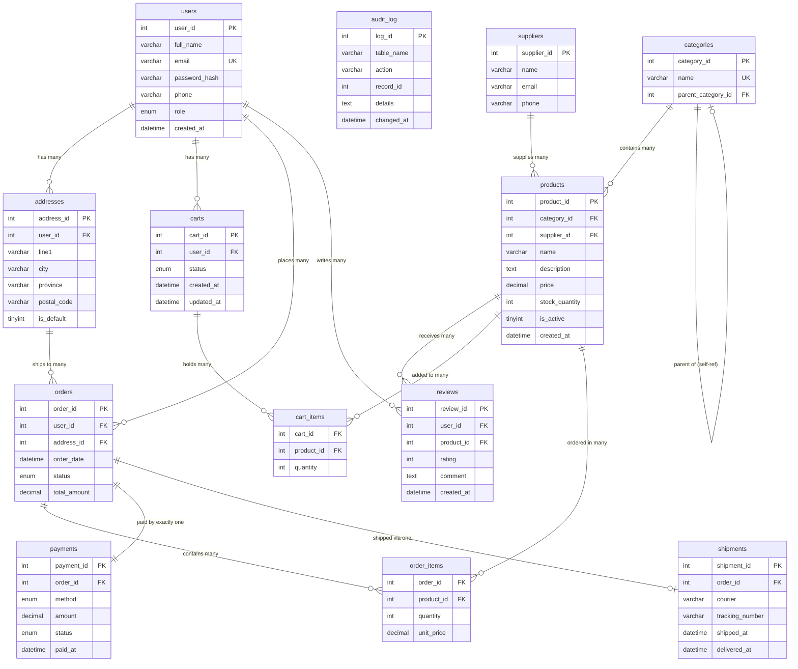

# ER Diagram – Online Shopping System
**MUET DBMS CEP | Department of Software Engineering**

All 13 tables and their relationships are shown below.
To export as PNG: open this file in VS Code with the Mermaid Preview extension,
or paste the diagram block into https://mermaid.live and download.

## Relationship summary (for the report)

| Relationship | Type | Why |
|---|---|---|
| users → addresses | 1 to many | A customer can have multiple delivery addresses |
| users → carts | 1 to many | Each shopping session creates a new cart |
| users → orders | 1 to many | A customer places many orders over time |
| users → reviews | 1 to many | A customer can review many products |
| categories → categories | self-reference | Allows sub-categories (e.g. Electronics → Mobiles) |
| categories → products | 1 to many | Each product belongs to one category |
| suppliers → products | 1 to many | One supplier provides many products |
| products → reviews | 1 to many | A product receives many customer reviews |
| carts ↔ products | many to many | Resolved by cart_items junction table |
| orders ↔ products | many to many | Resolved by order_items junction table |
| orders → payments | 1 to 1 | Every order has exactly one payment record |
| orders → shipments | 1 to 0-or-1 | Shipment is created only after payment |
| addresses → orders | 1 to many | An address can be used for multiple orders |

## Key design note
`order_items` stores `unit_price` (copied from the product at checkout time).
This is intentional: if the product price changes later, old order totals must
remain correct. This is a classic example of denormalization done on purpose.
