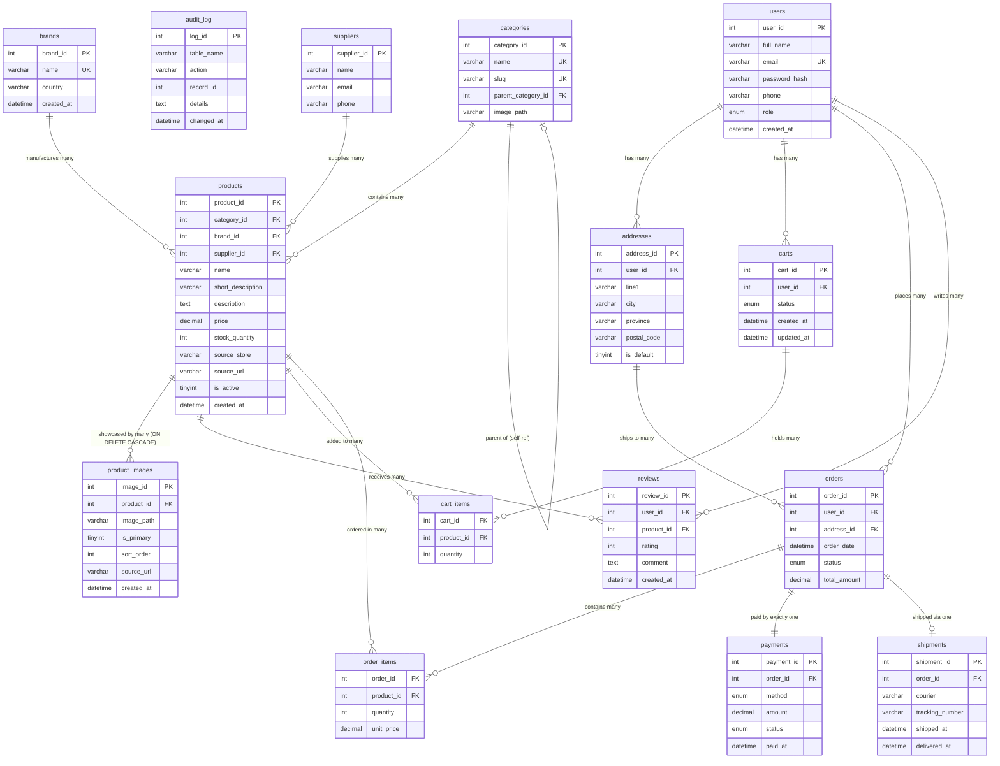

# ER Diagram – Online Shopping System (Expanded Phase 11)
**MUET DBMS CEP | Department of Software Engineering**

All 15 tables and their relationships are shown below (including Phase 11 Brand Management and Multi-Image Catalog Gallery entities).
To export as PNG: open this file in VS Code with the Mermaid Preview extension,
or paste the diagram block into https://mermaid.live and download.

## Relationship summary (15 Entities in 3NF)

| Relationship | Type | Why |
|---|---|---|
| brands → products | 1 to many | A brand produces multiple catalog items; product retains brand_id FK |
| products → product_images | 1 to many | A product has multiple gallery pictures (ON DELETE CASCADE) |
| users → addresses | 1 to many | A customer can have multiple delivery addresses |
| users → carts | 1 to many | Each shopping session creates a new cart |
| users → orders | 1 to many | A customer places many orders over time |
| users → reviews | 1 to many | A customer can review many products |
| categories → categories | self-reference | Allows multi-level departmental hierarchy (Laptops & Computers → Laptops) |
| categories → products | 1 to many | Each product belongs to one specific category |
| suppliers → products | 1 to many | One supplier provides many products |
| products → reviews | 1 to many | A product receives many customer reviews |
| carts ↔ products | many to many | Resolved by cart_items junction table |
| orders ↔ products | many to many | Resolved by order_items junction table |
| orders → payments | 1 to 1 | Every order has exactly one payment record |
| orders → shipments | 1 to 0-or-1 | Shipment is created only after payment settlement |
| addresses → orders | 1 to many | An address can be used for multiple orders |

## Key design notes
1. `order_items` stores `unit_price` (copied from the product at checkout time). This deliberate denormalization preserves accounting audit records against future catalog price updates.
2. `product_images` isolates media storage from core product rows into an atomic 1-to-N relation, preventing 1NF violations and eliminating string-splitting queries.
